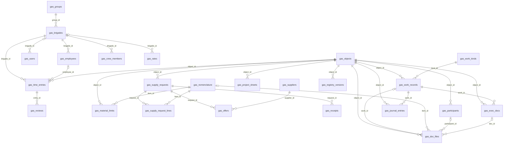

# Передача на бэкенд: neeklo FieldOps и ГАЙКА

Состояние на 31.10.2026: ветка `feature/service-v1` после S8 (сервис v1: учёт времени бригад,
снабжение, исполнительная документация, лендинг). Разделы 0–8 написаны 25.10 по `main`
и обновлены там, где S1–S8 их изменили. Раздел 9 — модули сервиса v1, его читать первым, если
задача про `/gas`. Каждое утверждение проверено по коду; где проверить не удалось, так и написано.

Порядок чтения: раздел 0 — до первой строки кода; разделы 1–3 — карта; 4–7 — работа;
8 — чего нет; 9 — модули сервиса v1 и пять первых задач.

---

## 0. Три вещи до начала работы

1. **Репозиторий на GitHub публичный, а в нём лежат название газового заказчика и его данные.**
   Файлы: `src/server/customer-data.ts`, `src/data/mock/fact-report*`, `src/data/mock/gas-ops-seed*`,
   снимки в `docs/launch/after/`. ADR-047 не пускает их в клиентскую сборку (это стережёт
   `scripts/check-public-bundle.ts`), но на GitHub их читает любой. Решение за владельцем:
   закрыть репозиторий или вынести данные заказчика в базу и убрать из истории.
2. **Рабочей базы нет.** Живой адрес работает в демо-контуре: данные приложения — во вкладке
   зрителя (`sessionStorage`), учёт выработки `/gas` — в `localStorage` браузера. PostgreSQL
   для рабочего контура (Neon или свой сервер) не заведён ни разу.
3. **`SESSION_SECRET` в рабочем контуре обязателен.** Подпись cookie без него берёт ключ,
   производный от `DEMO_ACCESS_KEY`, а затем случайный на процесс. Хэш кодов входа и токенов
   приглашений без него солится константой `"fieldops"` из этого же публичного репозитория
   (`src/api/auth-store.ts`). Для шестизначного кода соль почти ничего не меняет, но вариант
   «работает без секрета» в рабочем контуре должен падать, а не тихо продолжать.

---

## 1. Что это за система

Одна сборка, несколько поверхностей:

| Поверхность | Адреса | Что там |
| --- | --- | --- |
| Публичный сайт | `/`, `/case/gas`, `/razbor`, `/kit`, `/privacy` | лендинг, кейс, форма заявки (ADR-047, ADR-050, ADR-051) |
| Вход в демо | `/demo` | выбор сценария и роли, три сценария ГАЙКИ (ADR-037, ADR-038) |
| Приложение ГАЙКА | `/app`, `/today`, `/check`, `/attention`, `/inbox`, `/capture`, `/more`, `/projects/*` | рабочие экраны ролей, запись факта голосом, текстом и фото (ADR-033…046) |
| Учёт выработки бригад | `/gas/*` | бот бригадира, табель, сводка, выгрузка (ADR-043, ADR-044, ADR-049) |
| Кабинет компании | `/office/*` | справочники и подключения (этапы D4 и L7) |
| Прежние модули FieldOps | документация, материалы, закупки, поставки | **за флагом** `VITE_LEGACY_MODULES=1` (ADR-034, п. 4): код и тесты живы, в навигации их нет |

Продуктовый документ — `docs/gaika/`, план — `docs/FIELDOPS_AI_NATIVE_PLAN.md`, решения —
`docs/adr/` (49 ADR, номера до 051). Запуск L0–L10 и его журнал — `docs/launch/`.

---

## 2. Архитектура: куда смотреть

```
src/contracts   схемы zod: единственный источник формы данных для всех слоёв
src/domain      правила и формулы с тестами (tests/domain)
src/ports       интерфейсы: что система умеет, без «как»
src/adapters    реализации портов: demo, db, ai, speech, leads, channels, …
src/api         серверные функции (createServerFn) и сборка репозиториев сервера
src/routes/api  HTTP-маршруты: выгрузки, заявки, приём ошибок
src/server      модули только для сервера (данные заказчика, ответы)
```

Границы слоёв держит линтер (`no-restricted-imports` в `eslint.config.js`): серверные модули и
адаптеры данных нельзя импортировать там, где им не место. Бизнес-правила — только в `src/domain`.

**Как выбирается реализация данных.** Сборка: `VITE_DATA_SOURCE=demo` (публикуемая
демонстрация, `.env.production`) или `server` (рабочий контур, `.env.server`). На сервере
(`src/api/server-repositories.ts`): задан `DATABASE_URL` — адаптер PostgreSQL, не задан —
демо-адаптер в памяти процесса без сохранения.

**Серверная поверхность.** 91 серверная функция в шести файлах: `src/api/functions.ts` (69,
данные приложения), `auth-functions.ts` (9, вход и приглашения), `supply.ts` (6), `ai.ts` (3),
`speech.ts` (2), `gas-contour.ts` (2). HTTP-маршруты:

| Маршрут | Назначение |
| --- | --- |
| `POST /api/leads` | заявка с сайта; 204 / 400 / 429 / 501 / 502 (ADR-051) |
| `GET /api/export/projects`, `GET /api/export/shift`, `POST /api/gas/export` | выгрузки в Excel |
| `GET /api/office/connections` | состояние подключений без ключей |
| `POST /api/client-error`, `POST /api/feedback` | приём ошибок клиента и обратной связи |

**Права проверяются на сервере** (ADR-012). Матрица — `src/domain/access.ts`. Каждая серверная
функция и выгрузка ходят через `requestRepositories()` → `guardRepositories`: без сессии любой
вызов отвечает 403, сотрудник действия берётся из подписанной cookie, а не из аргументов.
Скрытый пункт меню защитой не считается.

---

## 3. Порты: что работает по-настоящему

| Порт | Демо | Настоящая реализация | Состояние и задача бэкенда |
| --- | --- | --- | --- |
| Данные: `projects`, `documents`, `positions`, `procurement`, `reports`, `timeline`, `catalog`, `directory`, `scope`, `supply`, `processing` | `src/adapters/demo` | `src/adapters/db` (ADR-005) | есть, проверен паритетом с демо; см. раздел 4 про запись |
| `ModelGateway` — разбор фраз и ответы модели | `ai/demo.ts`, подготовленные разборы | `ai/openai-compatible.ts`, по умолчанию `LLM_PROVIDER=deepseek` | включается `AI_MODE=live`; ключи не заданы, live на опубликованном адресе не проверялся |
| `SpeechPort` — распознавание речи | `speech/demo.ts` | `speech/openai.ts` (`/audio/transcriptions`) | работает при `STT_*`; **Yandex — заглушка**: `speech/yandex.ts` всегда отвечает `SpeechNotConnectedError` |
| `LeadSink` — заявки с сайта | нет приёмника: форма честно отвечает 501 | Telegram или вебхук (`adapters/leads`) | задать `LEADS_*` |
| `InboundChannel` — приём сообщений из Telegram | — | **нет** (`connected: false`) | спроектировать и сделать; нужен `TELEGRAM_BOT_TOKEN` |
| Чтение фото и PDF (DocumentReader из плана) | — | **порта нет** | спроектировать по плану, раздел 5 |
| `GasOpsPort` — учёт выработки `/gas` | `gas-ops/demo.ts`, хранение в `localStorage` | таблицы и хранилище базы есть (раздел 9), методы порта пока над вкладкой | задача 1 раздела 9 |
| `GasSupplyPort`, `GasDocsPort` — снабжение и ИД | `gas-ops/*-demo.ts` над `demoStore` | те же адаптеры над `createGasDbStore` (ADR-060) | паритет в `check:db`; нужны вход и серверные функции (раздел 9) |
| `AgentPort` — ассистент | собирается поверх портов данных (ADR-006) | тот же | ответы только с источником; модели в нём нет |
| `AnalyticsPort` | создаётся только после согласия человека | Метрика (`VITE_METRIKA_ID`) | — |

Правила для любой новой реализации портов ИИ (план, раздел 5): ответ модели проходит схему zod,
невалидный не применяется; модель не вызывает действий сама, действие делает сервер после
подтверждения человека; ключи не уходят на клиент.

---

## 4. База данных

- **Миграции:** `db/migrations` (10 файлов, `dbmate`), применять `bun run db:migrate`. Схема
  описана в `docs/db/schema.md` и `docs/db/schema.sql`.
- **Наполнение:** `bun run db:seed` — фикстуры демонстрации; `bun run db:owner` — первый
  руководитель на пустой базе заказчика. Порядок работы — `docs/runbook/database.md`.
- **Проверка:** шаг конвейера `check:db` поднимает свою базу, накатывает миграции, сверяет
  колонки с контрактами, проходит паритет «демо против базы» и проверяет версию данных при
  одновременной записи с двух серверов. Нужен PostgreSQL 16 с правом `CREATEDB`
  (`CHECK_DATABASE_URL`).
- **Драйвер:** `DATABASE_DRIVER=pg` для Node на своём сервере, `neon` — HTTP-драйвер для
  Cloudflare Workers.

**Как пишет адаптер — главное, что нужно знать.** Страницы, счётчики, реестр, карточка объекта
и права — запросами SQL (`src/adapters/db/sql.ts`). Все остальные чтения и **все записи** идут
«мостом снимка»: таблицы области загружаются, сборщик строит то же состояние, что у демо,
выполняется тот же метод демо-адаптера, разница пишется одним пакетом с проверкой версии
(конфликт версии — повтор). Так правила домена не дублируются, а паритет с демо доказуем.

Цена этого решения растёт с объёмом данных: запись тянет таблицы своей области. На демо-наборе
это незаметно. Для рабочего контура разумный путь — переписывать на прямой SQL горячие записи
по мере роста, начиная с записи факта (`reports.capture`) и заявок на материал (`supply.*`),
и держать шаг паритета зелёным после каждого переноса.

**Модули `/gas` (S4–S6) в базе — черновик S8 (ADR-060):** миграция
`20261031100000_gas_service_v1.sql` из контрактов `src/contracts/gas.ts`, хранилище
`src/adapters/gas-ops/db-store.ts`, сиды `bun run db:gas-seed`. Подробно — раздел 9.
Опубликованный адрес по-прежнему хранит `/gas` во вкладке браузера.

---

## 5. Вход и сессии

- Вход по телефону и коду, приглашения по ссылке (ADR-021). Код — шесть цифр, хэшируется
  перед записью в базу.
- **Канал доставки кода один:** `AUTH_CHANNEL=log` — код пишется в журнал сервера и
  показывается на экране входа. Годится только для сопровождаемого запуска. Без настройки вход
  по коду выключен, внутрь пускают ссылкой-приглашением от руководителя. Нужен настоящий канал:
  SMS или сообщение в Telegram.
- Cookie `fieldops_session`, подпись — `src/lib/session-token.ts`.
- Демонстрация открывается по простой ссылке, без ключа — решение владельца 21.10.2026.
  Шлюз остался в коде (`src/server.ts`, `accessGate`) и включается `DEMO_ACCESS_GATE=on`
  вместе с `DEMO_ACCESS_KEY`; запрет индексации действует и без него.
- Личная ссылка заказчика на `/gas?c=` подписывается `CLIENT_LINK_KEY`.

---

## 6. Переменные окружения

Собраны поиском по коду этого коммита. Секреты — только в настройках хостинга, никогда в
репозитории.

| Переменная | Где | Зачем |
| --- | --- | --- |
| `DATABASE_URL`, `DATABASE_DRIVER`, `APP_TIME_ZONE` | сервер | рабочая база, драйвер `pg` или `neon`, пояс меток времени (по умолчанию `Europe/Moscow`) |
| `SESSION_SECRET` | сервер | подпись сессии и соль хэшей; см. раздел 0 |
| `AUTH_CHANNEL` | сервер | доставка кода входа; сейчас есть только `log` |
| `DEMO_ACCESS_GATE`, `DEMO_ACCESS_KEY` | сервер | `on` включает шлюз ключа; по умолчанию выключен, демо открыто |
| `CLIENT_LINK_KEY` | сервер | подпись личной ссылки заказчика `/gas?c=` |
| `AI_MODE` | сервер | `demo` (по умолчанию) или `live` |
| `LLM_PROVIDER`, `LLM_BASE_URL`, `LLM_API_KEY`, `LLM_MODEL`, `LLM_MODEL_CHEAP` | сервер | шлюз моделей (ADR-035) |
| `STT_PROVIDER`, `STT_BASE_URL`, `STT_API_KEY`, `STT_MODEL` | сервер | распознавание речи (ADR-040) |
| `AI_TIMEOUT_MS`, `AI_MAX_AUDIO_SEC` | сервер | пределы обращения к модели и длины записи |
| `LEADS_TELEGRAM_BOT_TOKEN`, `LEADS_TELEGRAM_CHAT_ID`, `LEADS_WEBHOOK_URL` | сервер | куда уходят заявки с сайта |
| `TELEGRAM_BOT_TOKEN` | сервер | приём из Telegram — когда появится реализация |
| `VITE_DATA_SOURCE` | сборка | `demo` или `server` |
| `VITE_LEGACY_MODULES` | сборка | вернуть прежние модули FieldOps |
| `VITE_DEMO_ACCESS_KEY` | сборка | запасной путь ключа демо; **попадает в клиентский бандл**, в рабочем контуре не использовать |
| `VITE_PUBLIC_URL`, `VITE_METRIKA_ID`, `VITE_CONTACT_*`, `VITE_PRICE_*`, `VITE_CASE_*`, `VITE_VIDEO_*`, `VITE_LEGAL_LINE`, `VITE_PRIVACY_FINAL`, `VITE_HOURS`, `VITE_RAZBOR_CREDIT` | сборка | тексты, цены и контакты публичного сайта |

На живом адресе на 24.10 не заданы `LEADS_*` и `CLIENT_LINK_KEY` (журнал запуска, L10).

---

## 7. Сборка, публикация, проверки

- **Хостинг:** Lovable поверх Cloudflare, сборка Vite + Nitro; пресет по умолчанию —
  Cloudflare. Публикация — кнопка **Publish → Update** в Lovable, собирается из `main`.
  Порядок, откат и восстановление — `docs/RUNBOOK.md`.
- **Lovable правит `main` сам.** Правки владельца из редактора приходят коммитами
  `gpt-engineer-app[bot]` и **не проходят конвейер**: за последние десять дней они трижды
  оставляли `main` красной (форматирование, устаревшие проверки). Опубликованную историю не
  переписывать, force push запрещён.
- **Конвейер:** `bun run ci` — 15 шагов: типы, линтер, тесты домена, фикстуры против схемы,
  ссылки в документах, шкала размеров, тексты интерфейса, PostgreSQL, две сборки, два порога
  бандла, данные заказчика в публичной сборке, сквозные тесты, Lighthouse. Прогон 25.10:
  15 из 15, сквозных 445 прошли и 18 пропущены, Lighthouse по медиане трёх замеров 82–84. Локально нужен `DATABASE_URL` на PostgreSQL 16.
- **Грабли среды:** сквозные тесты поднимают собранную демонстрацию
  (`NITRO_PRESET=node-server bun run build`); порт разводится `E2E_PORT`. Процессы глушить
  только по своему порту (`lsof -ti tcp:<порт> | xargs -r kill -9`), никогда по имени — это
  убивает чужие прогоны на той же машине.
- **Сквозные тесты зависят от интернета.** Шрифты Inter и JetBrains Mono грузятся с Google
  Fonts (`src/routes/__root.tsx`), а любая ошибка консоли роняет тест. 25.10 у машины пропала сеть посреди прогона — 32 падения, все
  `ERR_NAME_NOT_RESOLVED` и `ERR_INTERNET_DISCONNECTED`, ни одного по коду. Разумно отдавать
  шрифты со своего адреса: уйдёт внешняя зависимость, ускорится первая отрисовка, а браузер
  зрителя перестанет ходить к Google.
- **Пороги бандла** — `scripts/bundle-budget.json`, правило ADR-013: замер плюс 10 %, подъём
  только с объяснением в коммите.

---

## 8. Чего нет: честный список

Сделанное в интерфейсе работает на демо-данных. Для рабочего контура не хватает:

1. Рабочей базы: Neon или свой PostgreSQL, миграции, первый руководитель.
2. Хранения `/gas` на сервере в рабочем контуре: таблицы и хранилище базы есть (раздел 9),
   нет входа для ролей `/gas`, серверных функций и переноса порта учёта времени.
3. Канала доставки кода входа: SMS или Telegram вместо `AUTH_CHANNEL=log`.
4. Приёма сообщений из Telegram (`InboundChannel`).
5. Чтения фото и PDF: порта нет, рукописное — только с подтверждением человека.
6. Распознавания речи через Yandex SpeechKit: адаптер-заглушка.
7. Проверки ИИ в режиме `live` на опубликованном адресе: ключи не заданы.
8. Переноса горячих записей адаптера базы с моста снимка на прямой SQL — по мере роста данных.
9. Скорости первого экрана приложения на телефоне: на живом адресе `/gas` рисуется за 4,8 с
   (журнал запуска, L10) — экраны приложения собираются в браузере. Сайт и `/demo` в норме.
10. Решения владельца о публичности репозитория и данных заказчика в нём.

Открытые вопросы к владельцу: какой провайдер речи и модели берём в рабочий контур; где живёт
база (Neon или сервер заказчика); как доставляем код входа; остаются ли прежние модули
FieldOps в продаже или только за флагом.


---

## 9. Модули сервиса v1 (S4–S6): база, порты, роли, подключения

Решения: ADR-055 (сервис v1), ADR-056 (учёт времени), ADR-057 (снабжение), ADR-058
(исполнительная документация), ADR-059 (лендинг), ADR-060 (передача на бэкенд).

### 9.1. Сущности и связи

Контракты zod — `src/contracts/gas.ts`: 27 таблиц, 13 перечислений, ключи текстовые
(их создаёт приложение, демо и база хранят один и тот же ключ). Миграция генерируется из
контрактов: `bun run db:gas-schema` → `db/migrations/20261031100000_gas_service_v1.sql`;
тест `tests/db/gas-contracts.test.ts` держит файл равным выводу генератора. Состояние до S4
(неделя, сметы и их версии, правила стоимости, график, режим проверки, финальные проверки,
сданные отчёты) пока лежит одной строкой jsonb `gas_state`.



Где числа хранит домен, там же и база: деньги снабжения в копейках (`bigint`), начисления
учёта времени в рублях (`double precision`, как в отчёте заказчика), количества `numeric(14,3)`.
Ключи отправки с телефона уникальны частичными индексами у записей времени, заявок
и приёмок. У акта по работе один документ (`gas_exec_docs.work_id` уникален), у записи
журнала тоже. Журналы `gas_reviews` и `gas_audit` — только `insert`.

Без внешнего ключа намеренно: `gas_crew_members.employee_id` и `gas_rates.employee_id`
(демо-монтажники есть только в составе, со своим именем), `gas_supply_requests.chosen_offer_id`
(взаимная ссылка заявки и предложения).

### 9.2. Хранилище и порты: что настоящее

| Часть | Демо | База | Проверено |
| --- | --- | --- | --- |
| Хранилище `GasStore` (`adapters/gas-ops/store.ts`) | `demoStore` — вкладка | `createGasDbStore(driver)` — мост снимка с версией `gas_versions` | `check:db`: сид записан и прочитан без потерь |
| Снабжение `GasSupplyPort` | `createGasSupplyDemo()` | `createGasSupplyDemo(createGasDbStore(db))` | `check:db`: путь S5→S6 одинаков во вкладке и в базе, 18 шагов |
| Документы `GasDocsPort` | `createGasDocsDemo()` | `createGasDocsDemo(createGasDbStore(db))` | там же |
| Учёт времени `GasOpsPort` | `createGasOpsDemo()` | **нет**: методы читают вкладку напрямую | задача 1 |
| Одновременная запись | — | версия снимка, по которому принято решение; конфликт → `GasStaleError`, `retrying(port)` повторяет действие целиком | `check:db`: две заявки из двух хранилищ, разные номера |

Правила и права одни для обеих реализаций: адаптер проверяет роль и объект пользователя
до любого изменения. Сервер не повторяет правила, он вызывает тот же порт над базой.

### 9.3. Действия по ролям

Серверных функций для `/gas` **нет**: в демо роль выбирается на экране, и действующий
пользователь хранится в снимке (`actorId`). Для рабочего контура порт должен получать
пользователя из сессии, а не из снимка (задача 2). Права ниже проверяет порт.

| Действие | Кто может | Порт |
| --- | --- | --- |
| Внести, исправить, отправить запись времени | бригадир (своя бригада), менеджер, руководитель, администратор | `GasOpsPort.createEntry`, `updateEntry`, `submitEntry` |
| Проверить запись, отменить решение | менеджер, руководитель, администратор | `review`, `undoReview` |
| Закрыть и переоткрыть неделю, ставки | руководитель, администратор | `closeWeek`, `reopenWeek`, `setRate` |
| Создать заявку, принять поставку | прораб (свои объекты), снабженец, администратор | `GasSupplyPort.createRequest`, `acceptDelivery` |
| Взять в работу, предложения, выбор, «заказано», «в пути», поставщики | снабженец, администратор | `moveRequest`, `addOffer`, `chooseOffer`, `markOrdered`, `markInTransit`, `addSupplier` |
| Пакет актов, поля, статусы, реестр, журнал работ | ПТО, администратор | `GasDocsPort.createDocs`, `editField`, `moveDoc`, `closeRegistry`, `acceptJournal` |
| Файлы оснований (схема, испытания, сертификат) | ПТО, прораб, снабженец, администратор; приказ — только ПТО | `addFile` |
| Подтвердить объём | прораб (свои объекты), администратор | `confirmVolume` |
| Сметы, график, режим проверки, состав бригад | менеджер, администратор | `setEstimate` (также руководитель), `addEstimateVersion`, `applySchedule`, `addCrewMember`, `endCrewMember` |
| Видеть деньги | не бригадир и не прораб: их выборки без сумм и цен | `fieldFor`, `siteRequests` |

Роли снабжения и ИД (прораб, снабженец, ПТО) в учёт времени не входят. До S8 правила учёта
времени перечисляли запреты, и эти роли проходили их через порт; теперь у действий список
разрешённых ролей, тест `tests/negative/gas-module-roles.test.ts`.

Файлы собираются на сервере уже сейчас: `POST /api/gas/export` (отчёт недели),
`POST /api/gas/rfq` (запрос цены xlsx), `POST /api/gas/exec-docs` (акт docx, реестр xlsx,
пакет zip). Содержимое приходит телом; с базой тело станет ключом документа.

### 9.4. Подключения: что не подключено и где место в коде

| Подключение | Сейчас | Место в коде |
| --- | --- | --- |
| MAX (бот бригадира) | имитация в интерфейсе, канал не подключён; `maxId` сотрудника с меткой | экран `components/gas-ops/bot/BotChat.tsx`, разбор фразы `domain/gas-ops/parse-time-message.ts`; приёмник — новый порт по образцу `InboundChannel` (раздел 3) |
| Распознавание речи | прораб: Web Speech API браузера, если он умеет; бригадир: демо | `lib/ui/browser-speech.ts`; серверный `SpeechPort` (`adapters/speech`) — раздел 3 |
| Модель (разбор текста заявки, предложения полей) | не используется: разбор правилом по номенклатуре | `domain/gas-ops/supply.ts` `parseRequestText`; шлюз `ModelGateway` (раздел 3) |
| Хранилище файлов (фото, сертификаты, схемы, сканы) | хранится только имя файла | `FilePick` в `components/gas-ops/supply/common.tsx`, `DocFile.fileName`, `Receipt.certificates`; нужен порт файлов (S3-совместимое хранилище) и ключ файла вместо имени |
| PDF акта | печать браузера | `components/gas-ops/docs/DocScreen.tsx`; серверный PDF с кириллицей — шрифт и библиотека |
| Почта и заказ поставщику | система не отправляет и не заказывает (инвариант 9) | — |

### 9.5. Пять первых задач бэкенда

1. **Порт учёта времени над хранилищем.** Перевести `createGasOpsDemo` на `GasStore` так же,
   как снабжение и документы: чтение `store.read()`, запись `store.update(change, base)` со
   снимком, по которому принято решение, обёртка `retrying`. Добавить его путь в
   `scripts/check-db-gas.ts` и держать паритет зелёным.
2. **Вход и пользователь из сессии.** Роли `/gas` (`gas_users`) связать с входом по коду
   (раздел 5); порт получает пользователя параметром из сессии, а не из `actorId` снимка.
   Без этого серверные функции не узнают, кто действует.
3. **Серверные функции `/gas`.** `createServerFn` на каждое действие таблицы 9.3 поверх
   `retrying(port(createGasDbStore(driver)))`, ответы — выборки по роли (бригадиру и прорабу
   без денег), а не весь снимок. Выбор реализации — переменной `VITE_DATA_SOURCE`, как у ГАЙКИ.
4. **Хранилище файлов.** Порт файлов с двумя реализациями (демо: имя; сервер: S3-совместимое),
   ключ файла в `gas_doc_files`, `gas_receipts.certificates`, фото заявок; выдача по ссылке
   с проверкой роли.
5. **Прямой SQL на горячих путях.** Мост снимка читает все таблицы модулей на каждую запись.
   На данных одного заказчика это приемлемо; по мере роста первыми переписать запись времени,
   приёмку и смену статуса акта на точечные запросы, не меняя ответов (паритет в `check:db`).
