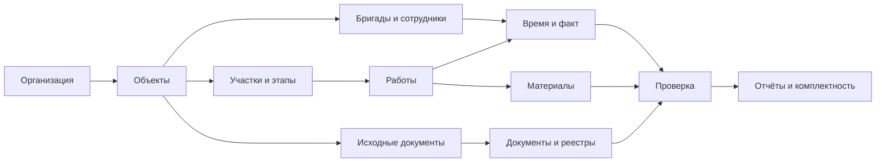

# Целевая архитектура ГАЙКИ

Дата: 15.11.2026. Основание: бриф `GAIKA_GAS_AUTOPILOT.md`, раздел 4. Документ не план работ,
а карта: что из цепочки уже есть, что ждёт бэкенда, что в roadmap. Реализуется по шагам.

## Цепочка сущностей

## Что есть

Метки: **есть** работает на данных в демо и в рабочем контуре пилота; **бэкенд** нужен
сервер или решение Сергея; **roadmap** не начато. Газовый заказчик видит только учёт времени:
снабжение и ПТО скрыты флагом `gaika-gas-only` (ADR-061).

| Звено | Состояние | Где | Чего не хватает |
| --- | --- | --- | --- |
| Организация | есть, одна на базу | `pilot.ts` (`emptyCompany`), `db:gas-init` (ADR-069) | Несколько компаний в одной базе: изоляция по `organization_id` (бэкенд, B2) |
| Объекты | есть | справочник, «Добавить объект», импорт (ADR-062) | Архив объектов: бэкенд не хранит признак архива, поэтому в интерфейсе его нет |
| Участки и этапы | roadmap | – | Модель захваток есть в основном приложении (`src/domain`), в газовом контуре нет |
| Работы | частично | разделы сметы, правило стоимости (`work-cost.ts`, ADR-053) | Работы как сущность с объёмами: roadmap |
| Бригады и сотрудники | есть | справочники, состав с периодами, импорт (ADR-056, ADR-062) | Приглашение по коду в `/gas`, привязка MAX (бэкенд, B6) |
| Время и факт | есть | форма бригадира, бот, разбор текста, автопилот (ADR-061, ADR-070) | Канал MAX: каркас и 501 без ключа (бэкенд, B6) |
| Материалы | есть под флагом | снабжение (ADR-057) | Скрыто у газового заказчика |
| Исходные документы | частично | сметы и график из Excel, хранятся разобранными | Хранилище исходных файлов (бэкенд, ADR-069 «не входит») |
| Документы и реестры | есть под флагом | ИД (ADR-058) | Скрыто у газового заказчика |
| Проверка | есть | очередь, правила, режимы, выборочная проверка, счётчик совпадения (ADR-070) | Отправка по расписанию на сервере (бэкенд, B6) |
| Отчёты и комплектность | есть | табель, неделя с версиями, Excel на сервере, сверка с файлом заказчика (ADR-061, ADR-063) | Облачная таблица: адаптер Google есть, решение D12 за заказчиком |

## Правила, которые держит архитектура

- Бизнес-правила только в `src/domain` с тестами. Порт один для демо и сервера,
  права и скрытие денег проверяет сервер (`src/api/gas-ops-server.ts`).
- Автопилот вызывает только операции домена через порт. Он не пишет в базу напрямую,
  не закрывает неделю и не меняет суммы (ADR-070).
- Пустой раздел в навигацию не выводится. Новое звено появляется в меню, когда за ним
  есть данные и права на сервере.
