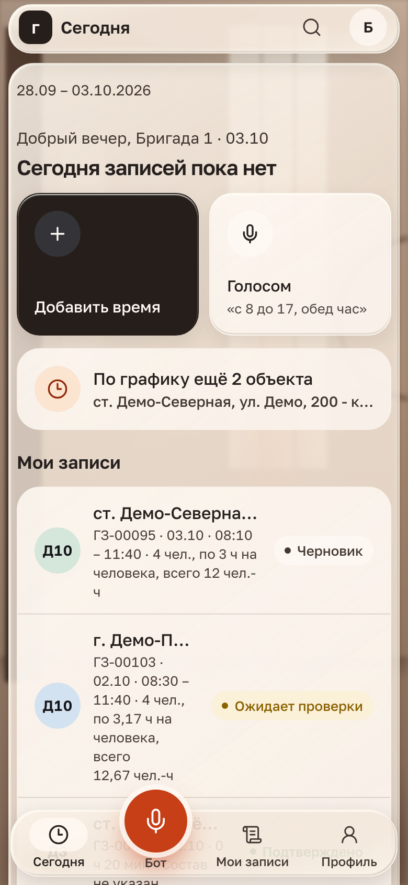
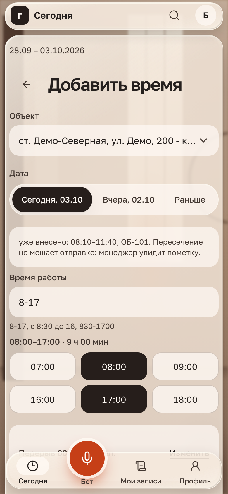
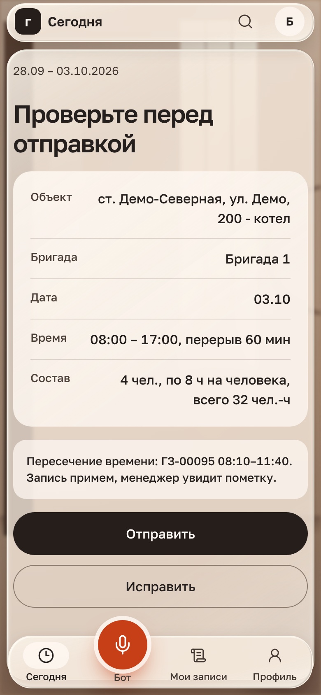
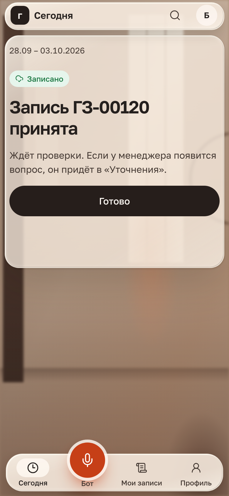

# Инструкция бригадиру

Время отправляете с телефона по своей ссылке. Ссылку пришлёт менеджер, сохраните её на
главный экран. Денег в приложении вы не видите, только время и записи.
Снимки ниже сделаны на демо-данных.

| | |
| --- | --- |
|  | **1.** «Сегодня» → **«Добавить время»**. Можно голосом: нажмите микрофон и скажите «с 8 до 17, обед час». |
|  | **2.** Выберите объект из графика, день, время работы (пишите «8-17» или нажимайте кнопки), перерыв. Если время пересекается с другой записью, вы увидите пометку, отправить всё равно можно. |
|  | **3.** Проверьте объект, время, перерыв и состав. **«Отправить»** или «Исправить». |
|  | **4.** Придёт номер записи. Повторное нажатие не создаст вторую запись. Вопрос менеджера появится на «Сегодня» в блоке «Уточнения»: ответьте там. Статус записей в «Мои записи». |

Нет связи на объекте: запись остаётся в телефоне с пометкой «Ждут отправки» и уходит сама,
когда связь появится.
