# Приёмка Сервиса v1 (S0–S8)

Дата: 31.10.2026. Ветка `feature/service-v1`, в `main` не слита (ждёт «ок» владельца).
Все цифры ниже — из прогона `bun run ci` с локальным PostgreSQL 16 на коммите S8
(15 шагов из 15, «Конвейер пройден»), если рядом не указана другая команда.

## 1. Пороги

| Проверка | Порог | Факт | Команда |
| --- | --- | --- | --- |
| Типы, линтер, тексты интерфейса, шкала размеров, ссылки | без ошибок | без ошибок | `bun run ci`, шаги 1, 2, 5–7 |
| Тесты домена, согласованности, негативные | все проходят | 1180 из 1180 | `bun run test` |
| Сквозные тесты (роли, «Монохром», axe, консоль) | все проходят | 471 прошли, 18 пропущены, 0 упали | `bun run test:e2e` |
| PostgreSQL: колонки базы = контракты | без расхождений | 71 таблица, 614 колонок, 45 перечислений | `bun run check:db` |
| Модули v1: вкладка = база | одинаковые ответы | 18 шагов S5 → S6, 3 отказа по правилам совпали | `bun run check:db` |
| Модули v1: одновременная запись | без потерь и дублей | обе заявки на месте, ЗК-00004 и ЗК-00005 | `bun run check:db` |
| Бандл рабочего контура | ≤ 867 КБ gzip | 850,9 КБ | `bun run check:bundle server` |
| Бандл демонстрации | ≤ 926 КБ | 907,9 КБ | `bun run check:bundle demo` |
| Самый большой кусок | ≤ 110 КБ | 105,9 и 106,9 КБ | `check:bundle` |
| Код лендинга | ≤ 90 КБ | 11,6 КБ | `check:bundle demo` |
| График (Recharts) по требованию | ≤ 108 КБ | 102,5 КБ | `check:bundle` |
| Чтение Excel по требованию | ≤ 165 КБ | 156,9 КБ | `check:bundle` |
| Данные заказчика в публичной сборке | нет | нет | `bun run check:public-bundle` |
| Lighthouse компьютер: доступность / практики | ≥ 95 / ≥ 90 каждый замер | 100 / 100 на трёх экранах | `bun run lighthouse` |
| Lighthouse компьютер: производительность | медиана ≥ 70 | 82, 80, 79 | `bun run lighthouse` |
| Lighthouse телефон: доступность | 100 | 100 на `/`, `/demo`, `/today`, `/gas`, `/gas/overview` | `bun run lighthouse` |
| Лендинг на телефоне: сдвиг вёрстки | CLS < 0,05 | 0,000 | `bun run lighthouse` |
| Лендинг на телефоне: первый экран | LCP ≤ 2,5 с | 8,3 с локально, **не проверено** на опубликованном адресе | см. раздел 9 |
| Первый экран лендинга в 390 × 664 | строка под кнопками ≤ 664 px | 629 px | `e2e/site.spec.ts` |
| Касание | 44, полевые 52, голос 56 | нижняя панель и голос 56, решение проверки 48 проверены; 44 и 52 заданы классами компонентов, общего теста нет | `e2e/bottom-nav.spec.ts`, `e2e/gas-review.spec.ts` |

## 2. Три сквозных пути

Каждый путь проходит на 390 и 1440 в одном прогоне.

1. **Учёт времени** — `e2e/crew-week.spec.ts`:
   - бригадир внёс время, видит «Принято сервером»;
   - менеджер исправил состав с причиной и принял;
   - руководитель закрыл неделю: файл v1;
   - переоткрытие с причиной: v2, файл v1 остаётся.
2. **Снабжение** — `e2e/supply.spec.ts`:
   - прораб создал заявку текстом;
   - снабженец ввёл два предложения, сравнил и выбрал, отметил «заказано» и «в пути»;
   - прораб принял с расхождением и сертификатом;
   - материал с сертификатом виден ПТО.
3. **Исполнительная документация** — `e2e/exec-docs.spec.ts`:
   - подтверждённые работы → пакет АОСР → нет сертификата;
   - снабжение везёт трубу, прораб принимает поставку с сертификатом;
   - комплект полный, черновик docx скачан;
   - «подписан» со сканом;
   - реестр закрыт v1.

## 3. Инварианты 1.4

| № | Инвариант | Чем проверен |
| --- | --- | --- |
| 1 | Неподтверждённое не в итоге; черновик помечен | `gas-ops-crew-week.test.ts` «показатели недели (инвариант 1)»; метка «Черновик» в docx: `gas-ops-exec-docs.test.ts` |
| 2 | Исправление подтверждённого — с причиной и версией | `gas-ops-crew-week.test.ts` «2: правка состава…»; возврат акта с замечанием даёт v2: `gas-ops-exec-docs.test.ts` |
| 3 | Закрытый период не меняется, переоткрытие → v2 | неделя: `gas-ops-crew-week.test.ts` «3: …», `e2e/crew-week.spec.ts`; реестр ИД версиями: `gas-ops-exec-docs.test.ts` |
| 4 | Повтор с тем же ключом — без дубля | записи, заявки, приёмки: тесты порта; в базе — уникальные индексы ключа, `tests/db/gas-contracts.test.ts`, `check:db` |
| 5 | Права в порту; финансов и чужих объектов роль не получает | `gas-ops-crew-week.test.ts` «5: выборка бригадира…», `gas-ops-supply.test.ts` «инвариант 5», `tests/negative/gas-module-roles.test.ts` (найдено и закрыто на S8) |
| 6 | ИИ только предлагает | разбор заявки — черновик строк с «Верно» у неуверенных: `gas-ops-supply.test.ts` «инвариант 6»; модель в модулях v1 не подключена |
| 7 | «Сохранено на телефоне» и «Принято сервером» не путаются | «Принято сервером» — `e2e/crew-week.spec.ts`, `e2e/supply.spec.ts`; ветка без сети сквозным тестом **не покрыта** |
| 8 | Никаких чисел вне данных | «Ставки не заданы», «Лимита по смете нет»: `gas-ops-crew-week.test.ts`, `gas-ops-supply.test.ts`; числа лендинга сверены с набором: `tests/site/landing-sample.test.ts` |
| 9 | Заказ, подписи и ИД система не выполняет | «заказано» и «подписан» ставит человек, «подписан» только со сканом: `gas-ops-supply.test.ts`, `gas-ops-exec-docs.test.ts` |

## 4. Права

- **Порт.** Матрица по ролям — docs/BACKEND_HANDOFF.md, 9.3. Порт проверяет роль и объект
  пользователя до любого изменения, одинаково над вкладкой и над базой: паритет в `check:db`
  включает три отказа по правилам.
- **Найдено на S8 и исправлено.** Правила учёта времени были написаны запретами, поэтому
  прораб, снабженец и ПТО через порт могли подтвердить запись с суммой, загрузить смету
  и поменять состав. Теперь там списки разрешённых ролей. Тест на старом коде падает,
  на новом проходит.
- **Нет.** Серверных функций `/gas` с пользователем из сессии пока нет: задачи 2 и 3
  передачи.

## 5. Поиск

`e2e/shell.spec.ts` на 390, 768 и 1440:

- запись находится по номеру без нулей, совпадение подсвечено, переход ведёт в журнал;
- «ё» равно «е»;
- на пустой результат — совет;
- бригадир не находит сумм, смет и людей.

На снимках приёмки нашёлся дефект: на выбранной строке подсветка была невидима.
Исправлено на S8.

## 6. Доступность

`e2e/a11y-launch.spec.ts`, axe без serious и critical в обеих темах:

- оболочка и экраны учёта времени;
- голос в боте;
- «Сегодня прораба» и черновик заявки;
- «Заявки»;
- «Документы» и редактор акта;
- лендинг с клавиатуры: порядок табуляции и видимый фокус.

## 7. Десять пар снимков

Скриншотов референсов владельца в репозитории нет (`refs/README.md`), поэтому пары
«референс / экран» собрать нельзя. Ниже пары «компьютер 1440 / телефон 390» тех же экранов,
светлая тема (кроме десятой). Файлы лежат в `s8/`, состояние для снимков создано портами
(заявка с двумя предложениями, пакет АОСР, реестр v1). Горизонтальной прокрутки и ошибок
консоли нет ни на одном.

| № | Экран | 1440 | 390 |
| --- | --- | --- | --- |
| 1 | Неделя руководителя | 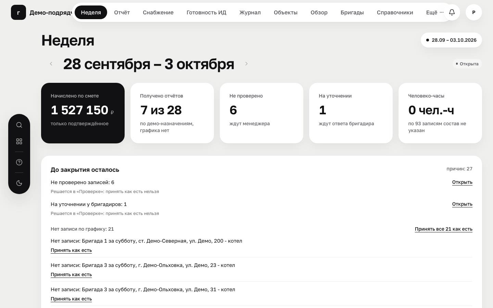 | 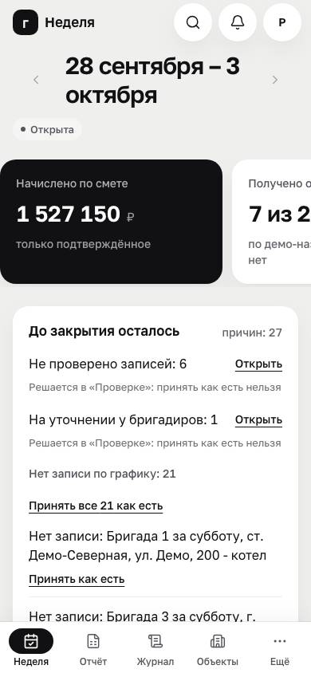 |
| 2 | Проверка менеджера | 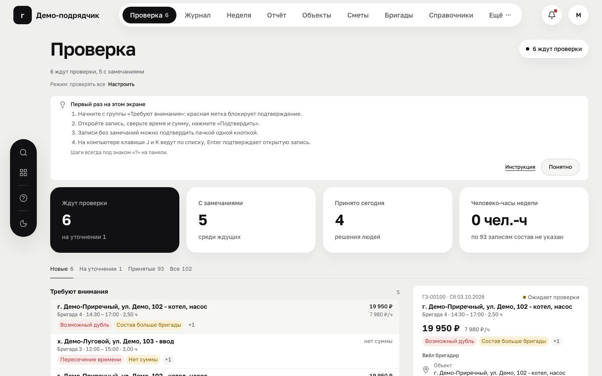 | 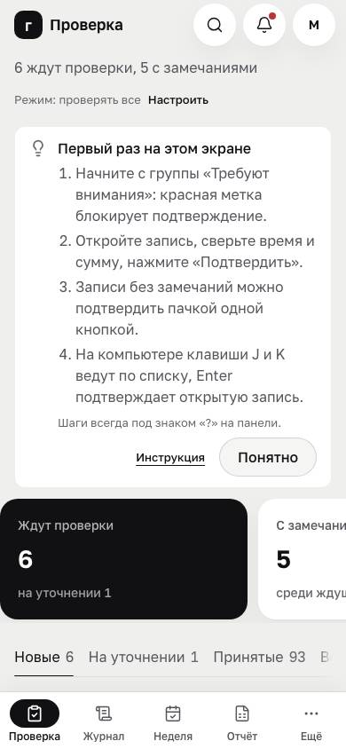 |
| 3 | Бригадир, «Сегодня» | 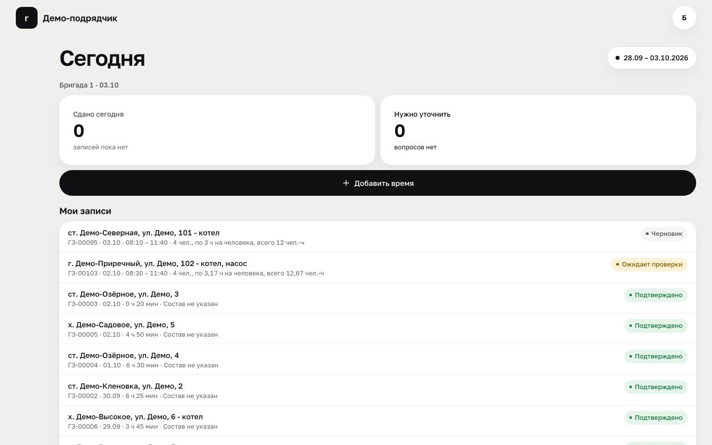 | 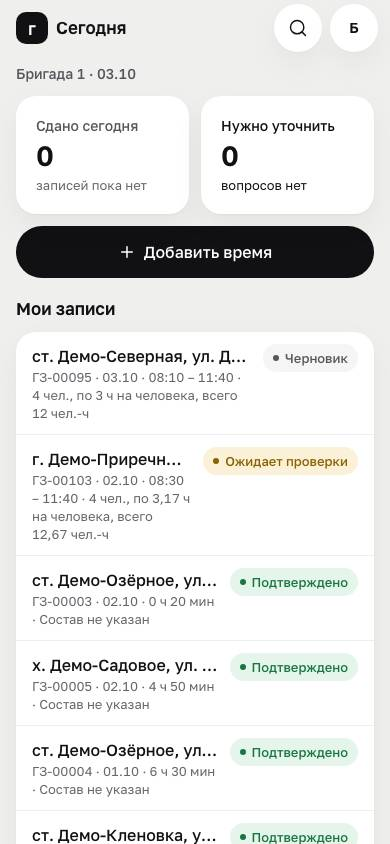 |
| 4 | Заявки снабженца | 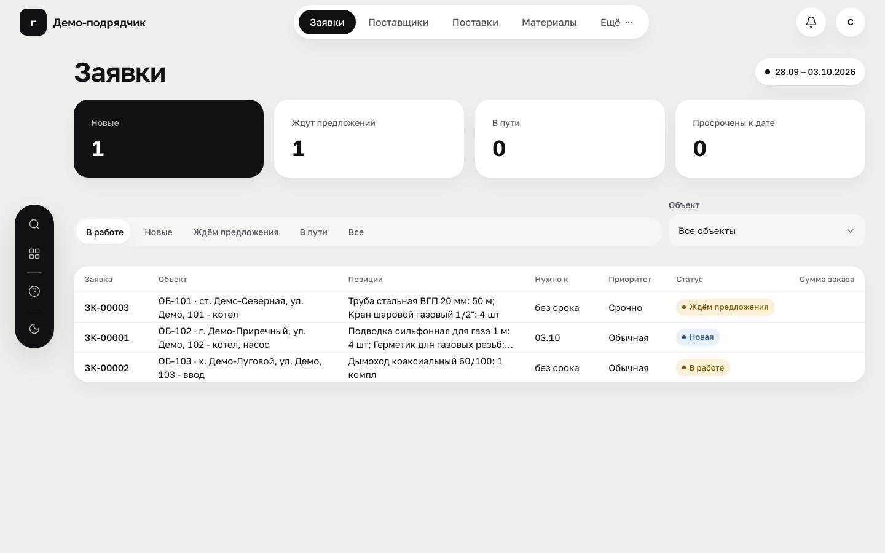 | 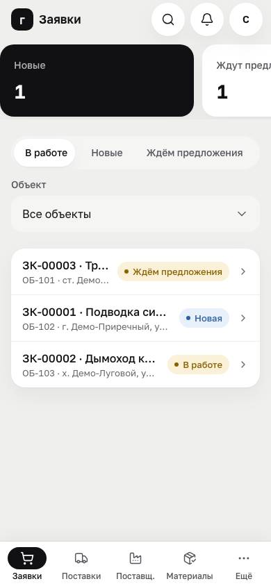 |
| 5 | Сравнение предложений | 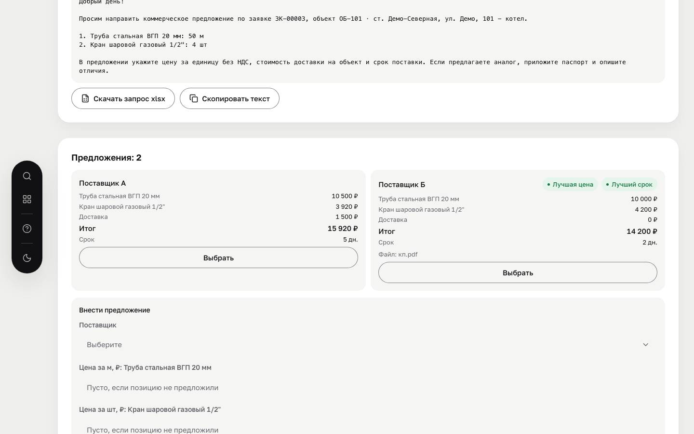 | 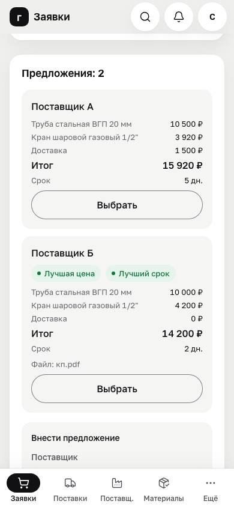 |
| 6 | Пакет АОСР («Документы» ПТО) | 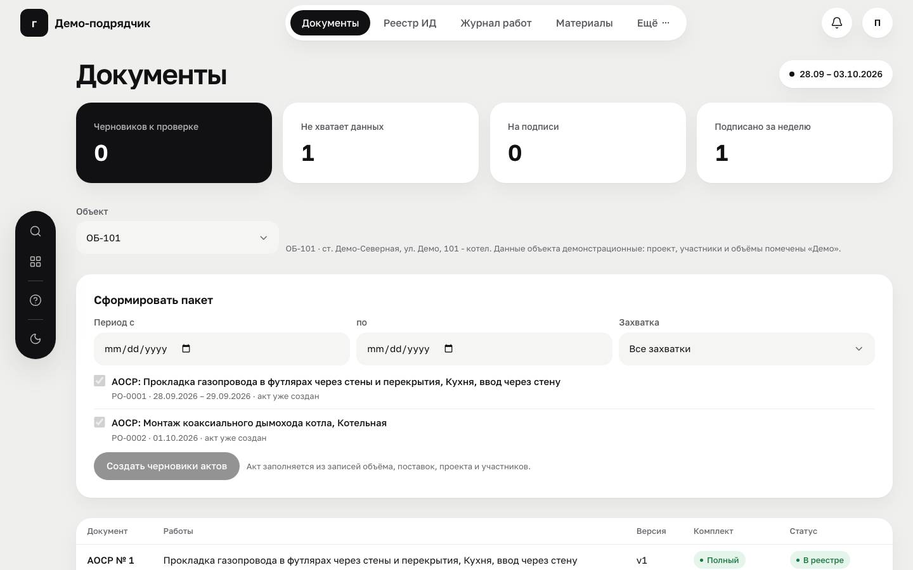 | 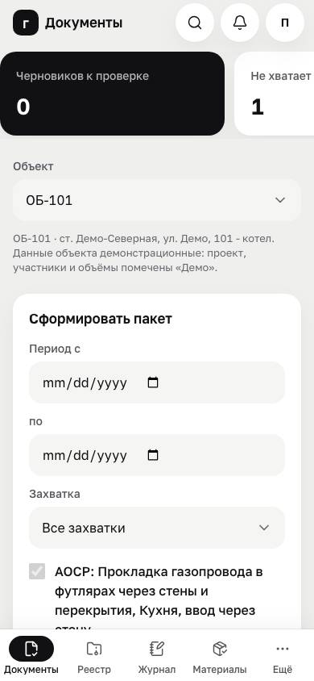 |
| 7 | Реестр ИД | 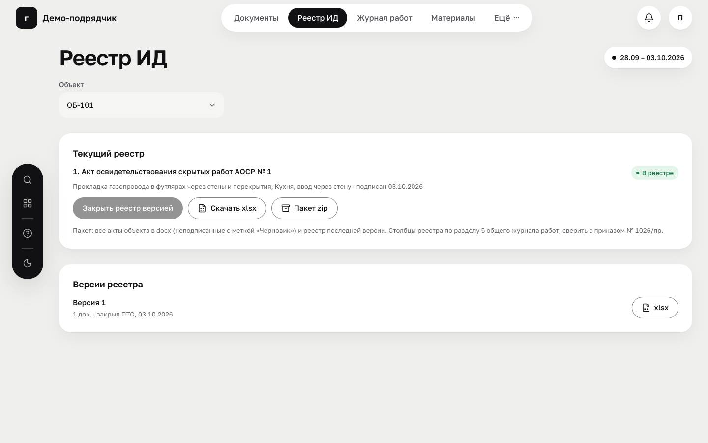 | 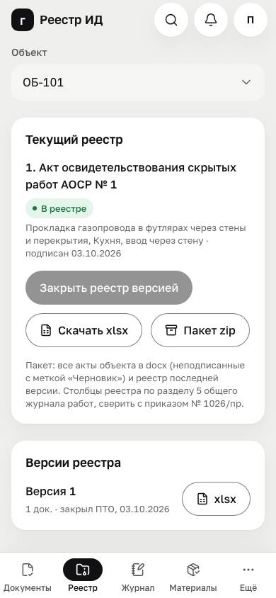 |
| 8 | Поиск | 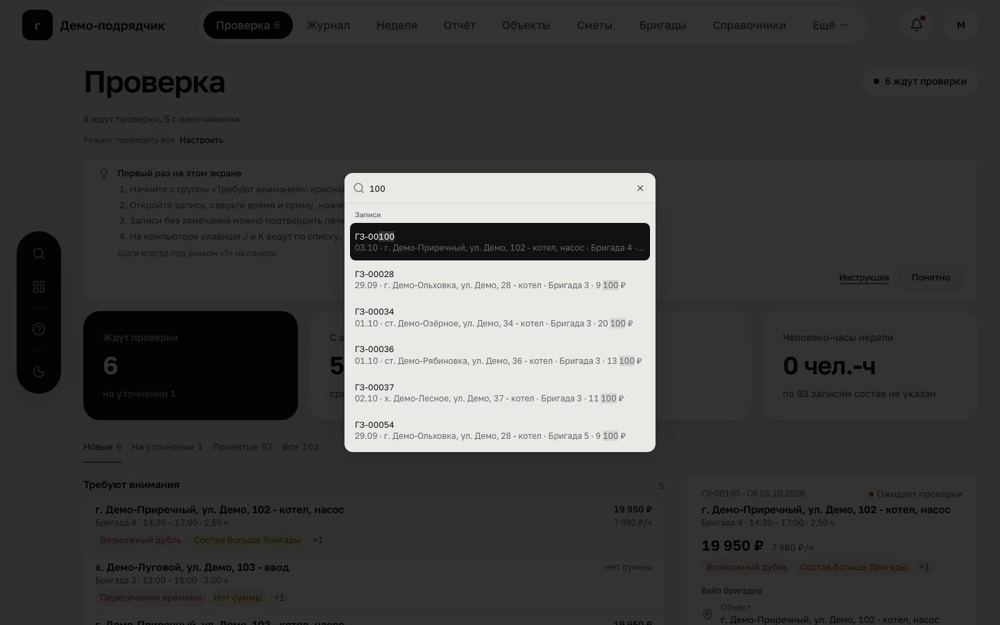 | 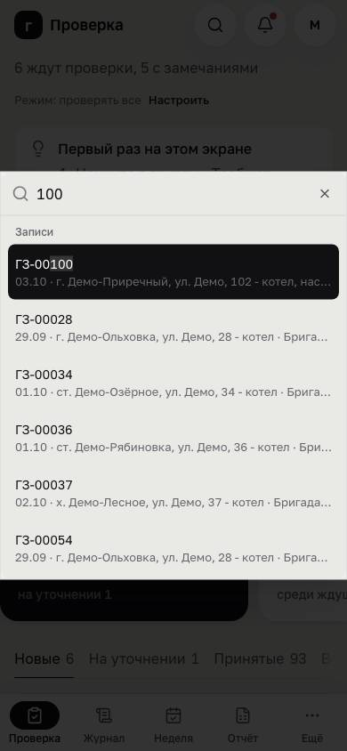 |
| 9 | Лендинг | 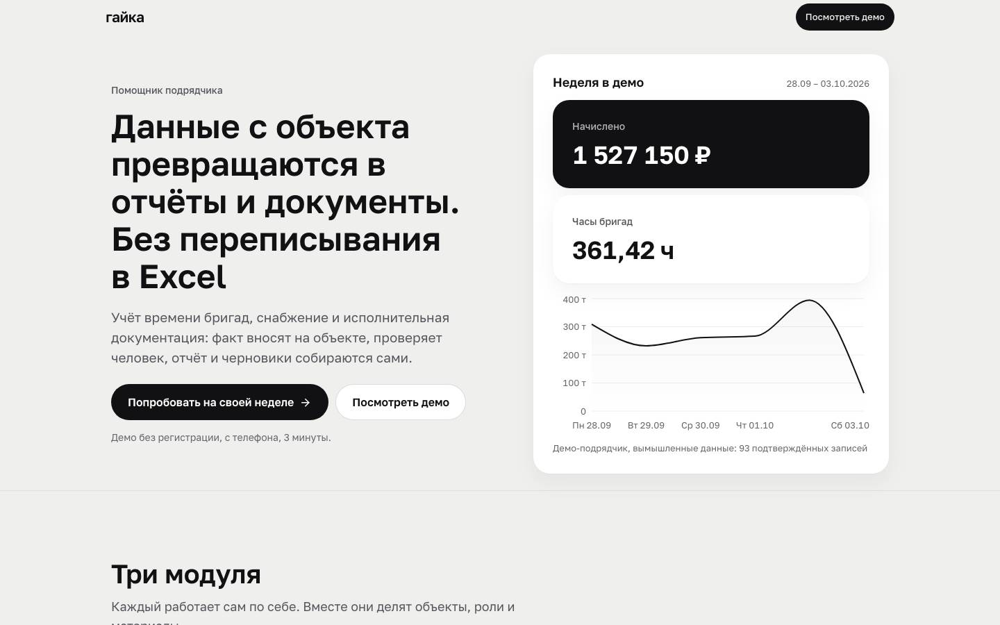 | 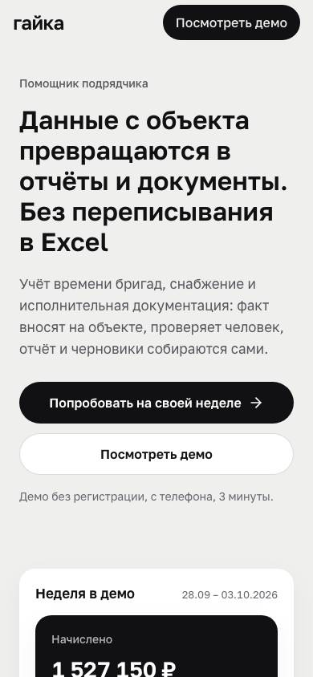 |
| 10 | Тёмная тема, неделя | 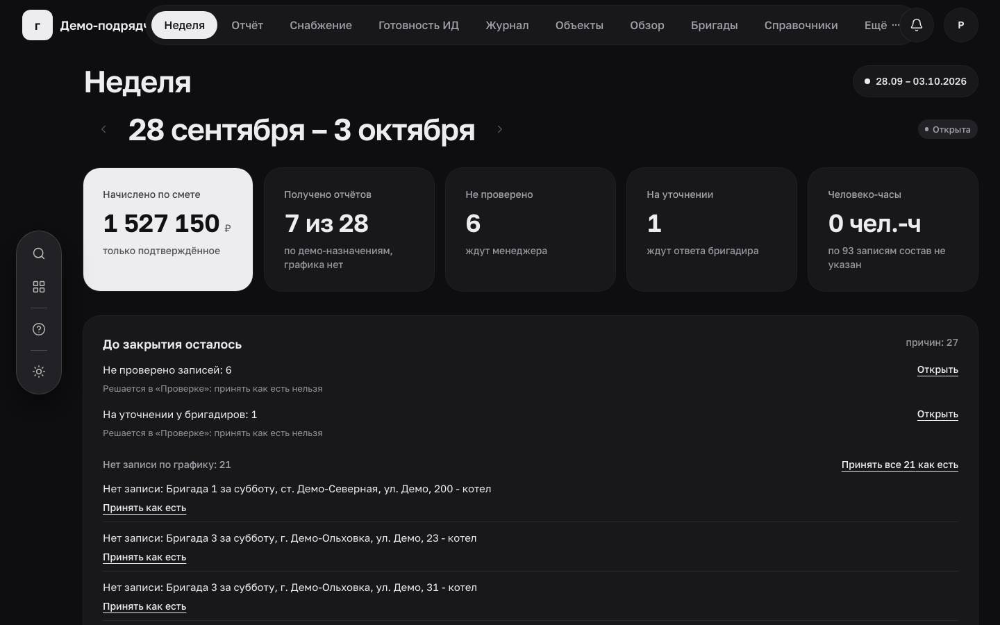 | 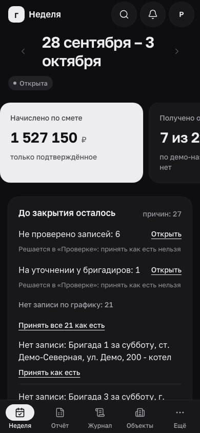 |

Снимки этапов: `s4/`–`s7/`, во всех ширинах и темах.

## 8. Локальная сеть

`bun run dev --host` → `http://192.168.18.102:8080/` (адрес машины в сети на 31.10.2026,
ответ 200 на `/gas`). Адрес меняется вместе с сетью: актуальный печатает сервер разработки
в строке `Network`.

## 9. Что не сделано и почему

1. **Учёт времени над базой.** Таблицы, хранилище и паритет сида есть, но 24 метода порта
   пока читают вкладку. Перевод затрагивает экраны и тесты S4. Задача 1 передачи.
2. **Серверные функции `/gas` и вход ролей.** В демо пользователь — `actorId` в снимке.
   Задачи 2 и 3.
3. **Хранилище файлов.** Фото, сертификаты, схемы и сканы хранятся только именами. Задача 4.
4. **Серверный PDF акта.** Сейчас его делает печать браузера; нужен шрифт с кириллицей.
5. **LCP лендинга 2,5 с на телефоне.** Локальный сервер отдаёт файлы без сжатия, поэтому
   цифра проверяется только на опубликованном адресе. Публикация — после «ок» владельца.
6. **Офлайн «Сохранено на телефоне»** сквозным тестом не покрыт, проверены очередь в коде
   и «Принято сервером».
7. **Референсы владельца.** Скриншотов нет, пары с референсом не собраны.
8. **MAX, распознавание речи на сервере, модель.** Не подключены по условию этапов.
   Места подключения — docs/BACKEND_HANDOFF.md, 9.4.
9. **Формы ИД** сверены по пересказу приказов № 344/пр и № 1026/пр. Дословный текст
   и применимость подтверждает специалист заказчика.
10. **В `main` не слито.** После «ок» владельца по постановке:
    - `git fetch`;
    - влить новые коммиты Lovable;
    - `bun run ci`;
    - merge-коммит без squash;
    - push без force.
