# Приёмка табеля T8

Ветка `feature/tabel-final`, 03.11.2026. Основание:
- docs/design/GAIKA_TABEL_FINAL.md, раздел 7, T8;
- ADR-061, решение 15.

В main не слито, Publish не нажимался: ждём «ок» владельца.

## Сквозной путь

`e2e/tabel-acceptance.spec.ts`, 390 и 1440. Проходит на обеих ширинах:
1. Бригадир на ОБ-101, где уже принята запись ГЗ-00095 08:10–11:40, вводит «с 8 до 17». Форма расшифровывает «08:00–17:00 · 9 ч 00 мин» и ставит пометку «Пересечение времени: ГЗ-00095».
2. Запись принята сервером.
3. Менеджер видит в очереди карточку с меткой «Пересечение».
4. Менеджер исправляет перерыв 60 → 30 мин с причиной «Со слов бригадира». В истории записи появляется «Минуты: 480 → 510». Затем менеджер принимает запись.
5. Руководитель принимает причины недели как есть, с текстом причины, и закрывает неделю: версия v1. Файл v1 скачан, в нём есть объект «ул. Демо, 101».
6. Переоткрытие с причиной, повторное закрытие: версия v2. Файл v2 скачан, кнопка файла v1 осталась.

## Пороги

| Проверка | Порог | Факт | Команда |
| --- | --- | --- | --- |
| Касания бригадира на типичную запись | не больше 5 | **5** («Добавить время», 08:00, 17:00, «Проверить», «Отправить») | `bunx playwright test e2e/tabel-acceptance.spec.ts` |
| Первый элемент очереди «Проверки» | не ниже 200 px на 1440 | **193 px** | то же |
| Таблица «Табеля» | начинается в первом экране | **1440:** верх сетки на 227 px из 900. **390:** верх списка на 168 px из 844 | то же |
| Переполнение | 0 на 390, 768, 1024, 1440 | **0** на семи экранах: бригадир, бот, проверка, журнал, табель, неделя, сотрудники | то же |
| axe | без serious, обе темы | **0** на девяти экранах (семь выше, помощник и тур) × 390 и 1440 × светлая и тёмная | то же |
| Lighthouse mobile `/gas/brigade` | первый экран до 2,5 с на 4G | **LCP 1,9 с** (медиана трёх, HTTP/2 со сжатием, как на хостинге). Подробности ниже | `bun run perf:first-screen` (шаг CI) |
| Консоль | ноль ошибок | **0**: оснастка `consoleGuard` роняет любой сквозной тест с ошибкой консоли | `bun run ci` |
| `bun run ci` | зелёный | **Зелёный: 16 из 16 шагов** (с новым шагом первого экрана). Юнит-тесты 1311, сквозные 534 прошли, 18 пропущены, 0 упали, Lighthouse пройден | `CHECK_DATABASE_URL=… bun run ci` |

### Что приёмка нашла и что исправлено

- **Журнал на 1024 был шире окна на 85 px.** Колонки с фиксированной шириной не помещались.
  - Сначала я обернул таблицу прокруткой вбок, но липкие строки дня наехали на первую строку: снимок `after/journal-1440-*` это показал. Обёртка откачена.
  - Решение: на ширинах 1024–1279 журнал не выводит колонки «Начало», «Оконч.», «Состав», «Чел.-ч». Интервал и человеко-часы есть в детали записи; от 1280 таблица прежняя.
- **axe, serious: прокручиваемая деталь в «Проверке» на компьютере была недоступна с клавиатуры.** Теперь это область «Подробности записи» с фокусом.
- **axe, critical: сетка «Табеля» — `div role="grid"` с обычной таблицей внутри.** Таблица стала раскладкой (`role="presentation"`), группы строк и заголовки названы ролями сетки явно.

### Lighthouse: первый экран бригадира

Замер `/gas/brigade` с ролью бригадира (проверено: на экране «Бригада 1 · 03.10», «Добавить время»).

**Первый вывод приёмки был неверным.** Сначала я мерил через локальный прокси по HTTP/1.1 и получил LCP 6,6 с. Разбор показал, что это свойство прокси, а не экрана:
- экран тянет 178 файлов скриптов (484 КБ после сжатия);
- по HTTP/1.1 браузер держит 6 соединений, и запросы стоят в очереди;
- опубликованный адрес отдаёт по HTTP/2: все запросы идут одним каналом.

| Условия | FCP | LCP |
| --- | --- | --- |
| HTTP/2 со сжатием, обычный 4G (9 Мбит/с, 170 мс), Lighthouse, медиана 3 | 1,5 с | **1,9 с** |
| HTTP/2 со сжатием, медленный 4G Lighthouse (1,6 Мбит/с, 150 мс), справочно | 2,0 с | 3,8 с |
| Для сравнения: HTTP/1.1 со сжатием, обычный 4G (так мерил первый раз) | 1,0 с | 6,6 с |
| Для сравнения: локальный сервер без сжатия (`bun run lighthouse`) | 6,2 с | 14,9 с |

Проверка реальным замедлением сети в браузере (не моделью Lighthouse), 4G и процессор ×4: экран с кнопкой «Добавить время» готов через **2,2 с** по HTTP/2 и через 6,3 с по HTTP/1.1.

Чтобы порог не мерился снова не в тех условиях, `bun run perf:first-screen` (шаг CI «Первый экран бригадира: 4G, HTTP/2»):
- поднимает прокси HTTP/2 со сжатием перед сервером демо-сборки;
- держит порог LCP 2,5 с на 4G;
- падает, если замер прошёл не по HTTP/2.

Решение — ADR-061, решение 16.

**Что остаётся.** На медленном 4G экран появляется за 3,8 с. Убрать 178 мелких файлов можно, но не бесплатно:
- если собрать иконки в один кусок, сайт и каждый экран будут тянуть иконки всего приложения;
- оболочка `/gas` подтягивает модули основного приложения (общая шапка и сброс демо).

Это отдельная работа, если нужен порог для медленного 4G. Цифру стоит снять и на опубликованном адресе после выкладки.

## Снимки «после» рядом с «до»

Снимки «после» — в `after/` на 1440 и 390, светлая и тёмная темы. Журнал снят ещё и на 1024. «До» — в `before/` (снято в T0 до изменений).

**Скриншотов ПТО Онлайн нет:** владелец их не передавал (`refs/README.md`), поэтому третьей колонки сравнения нет.

| Экран | До | После |
| --- | --- | --- |
| Бригадир, «Сегодня» 390 | 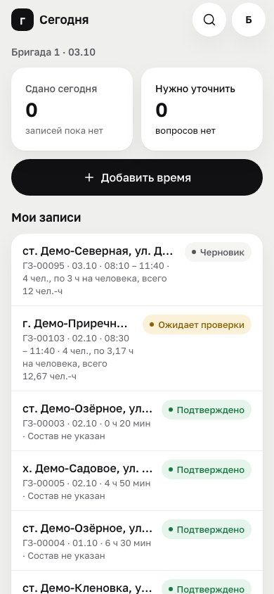 | 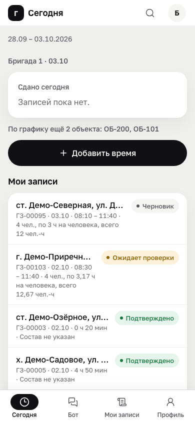 |
| Проверка 1440 | 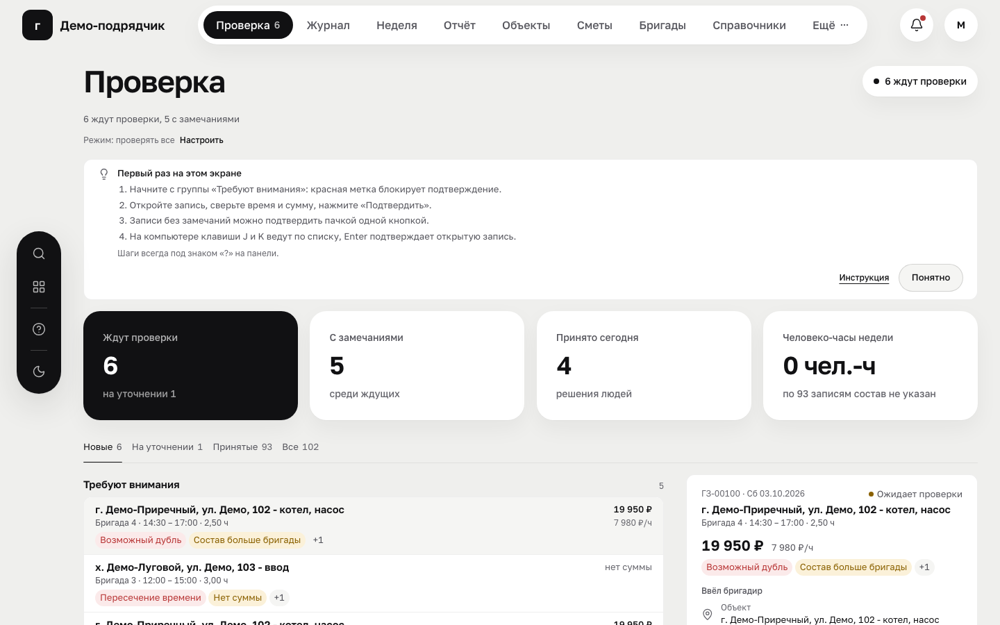 | 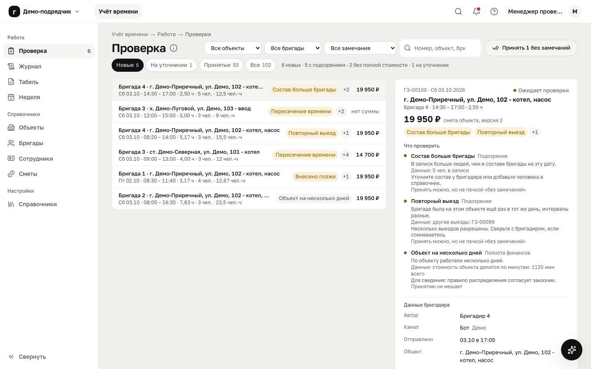 |
| Журнал 1440 | 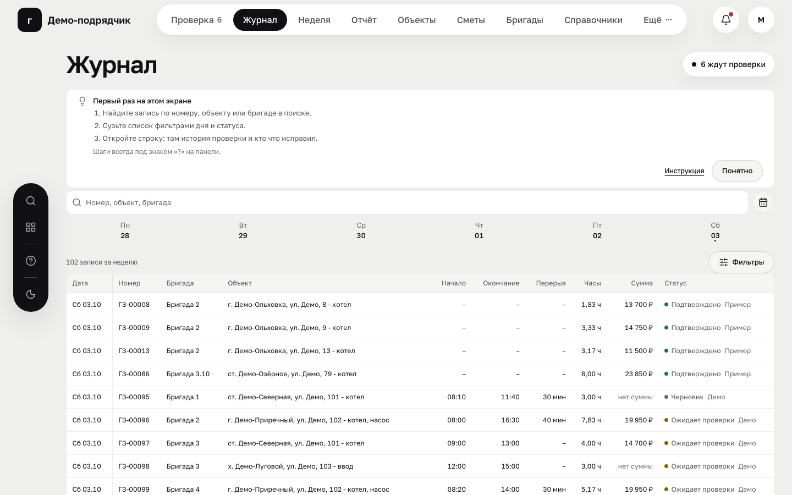 | 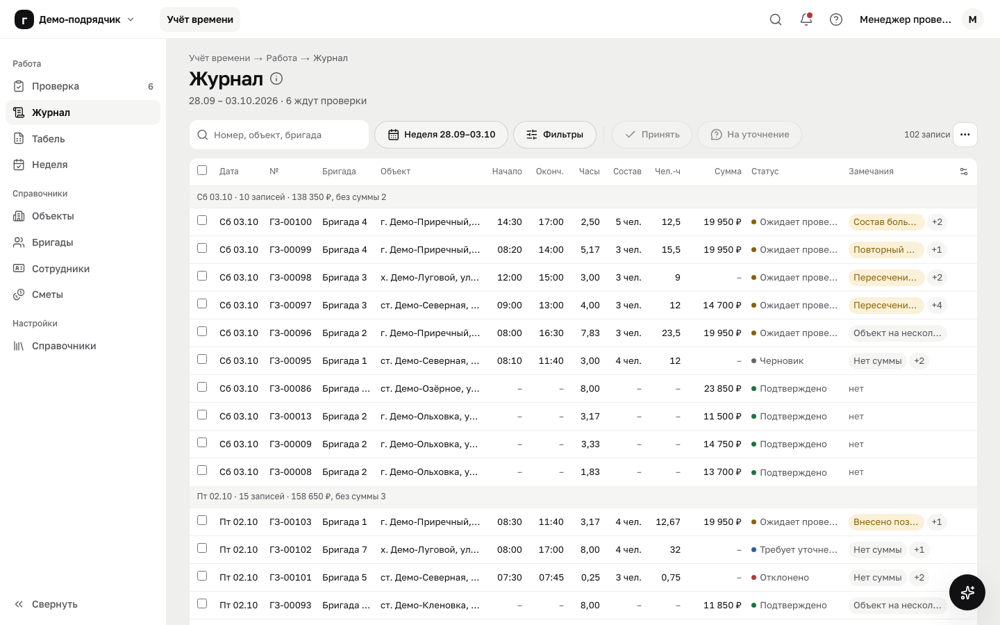 |
| Табель 1440 (до: «Отчёт») | 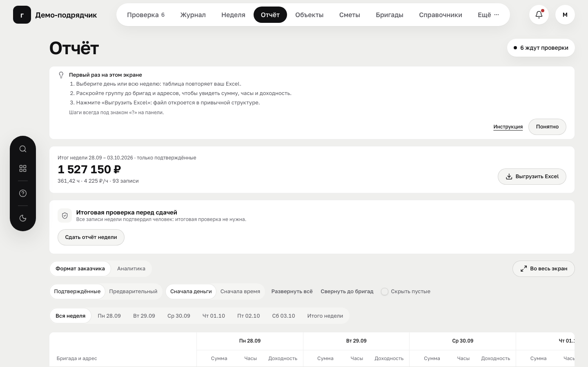 | 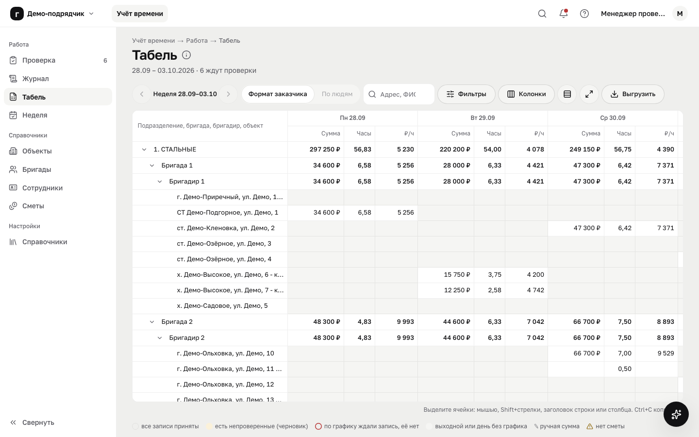 |
| Неделя 1440 | 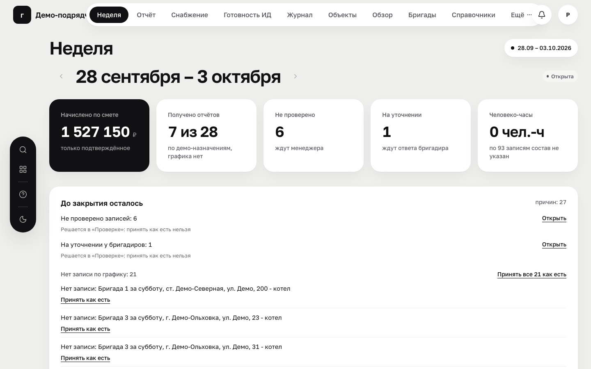 | 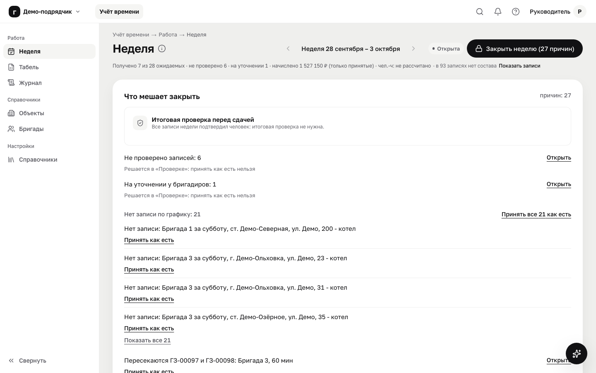 |
| Сотрудники 1440 | экрана не было | 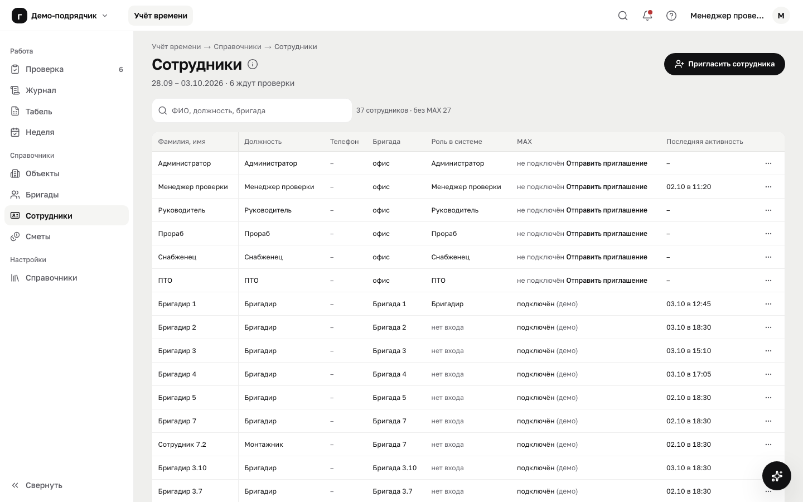 |
| Помощник 1440 | не было | 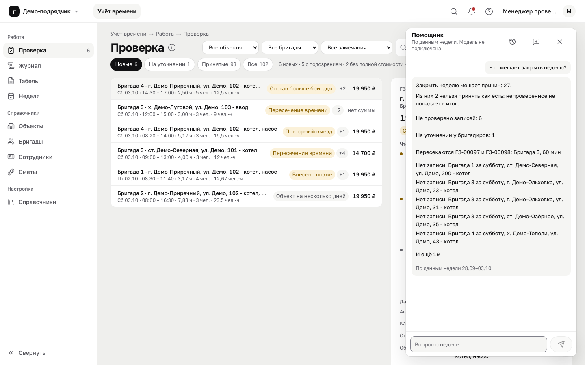 |
| Тур 390 | не было (полоса показа) | 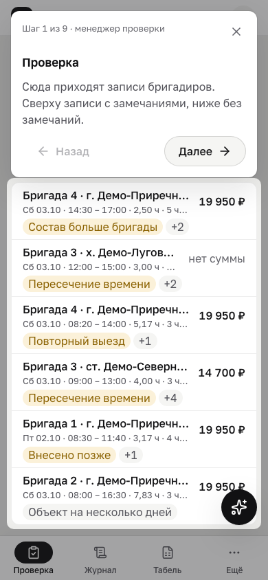 |

Тёмная тема и вторая ширина — файлы с суффиксами `-dark` и `-390`/`-1440` в той же папке. Каждый снимок перед сохранением проверен на фамилии и улицы из файла заказчика и на переполнение.

## Что не сделано

- **Первый экран бригадира на медленном 4G** — 3,8 с. Порог T8 задан для обычного 4G и выполнен (1,9 с); что даст медленный 4G — выше.
- **Сравнение со скриншотами ПТО Онлайн.** Нет скриншотов.
- **Живой канал MAX, пути `/api/v1`, связь входа по коду с ролями `/gas`.** Задачи бэкенда B3 и B6, см. docs/BACKEND_HANDOFF.md, раздел 10.
- **Замечание без исправления:** правка записи без изменения значений всё равно пишется в историю как «Исправлено» с причиной. Решить, отказывать ли в такой правке: это правило порта, тесты на него есть.
- **Выбор колонок журнала на ширине 1024–1279** по-прежнему предлагает четыре широкие колонки, но таблица их не выводит. Можно убрать их из выбора на узком экране или подписать «видно от 1280 px».

## Вопросы к Оксане и заказчику

1. **D05.** Как делить стоимость объекта по дням и бригадам, что с незавершёнными работами. Сейчас доля по минутам, со статусом «Требует согласования».
2. **D06.** Какая строка или формула сметы — «стоимость работ без материалов» для каждой из пяти форм.
3. **D07.** Нужны ли состав и человеко-часы; общий состав или время по людям. «У людей разное время» выключено флагом.
4. **D08.** Кто закрывает и переоткрывает неделю. Критерий «получено N из M»: по графику заказчика или по назначениям.
5. **D12.** Google или Яндекс таблица для синхронизации.
6. Эталонный расчёт по 3–5 объектам для golden-тестов.
7. Скриншоты кабинета ПТО Онлайн, если сравнение с ним ещё нужно.

## Проверка

- `bunx playwright test e2e/tabel-acceptance.spec.ts`: 13 тестов, все проходят. Вместе со спецификациями журнала, раскладки компьютера и тура — 39 из 39.
- `bun run ci` с локальной базой: 15 из 15 шагов со второго прогона.
  - Первый упал по времени на тесте имени продукта (15 с при нагруженной машине), отдельно он проходит за 0,35 с.
  - Итог: юнит-тесты 1311, сквозные 534 прошли, 18 пропущены, 0 упали, Lighthouse пройден.
  - Бандл: рабочий контур 887,6 КБ при пороге 905, демонстрация 944,0 КБ при пороге 945.
  - Lighthouse телефоном `/gas/brigade`: доступность 100, практики 100.
- После решения 16 `bun run ci` прошёл 16 из 16 шагов со второго прогона: в первом Chrome оборвал соединение посреди настольного замера `/projects/p-korona/procurement`, до замеров `/gas` скрипт не дошёл.
  - Шаг «Первый экран бригадира: 4G, HTTP/2»: FCP 1,6 с, LCP 2,0 с (медиана 3, порог 2,5 с), протокол h2.
  - Медленный 4G справочно: LCP 3,8 с.
